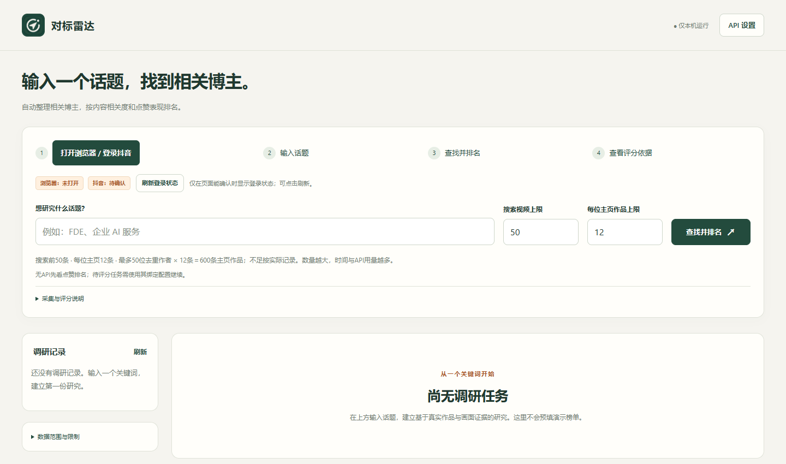

<p align="center"></p>

# 对标雷达

**输入一个话题，找到值得参考的抖音博主。**

本机运行的开源网页工具：从关键词搜索结果发现博主，读取作者主页的简介与作品卡片，用内容相关度和点赞表现生成可排序的对标表。

[开始使用](docs/QUICKSTART.md) · [功能与评分](docs/FEATURES.md) · [开发说明](docs/DEVELOPMENT.md) · [隐私说明](PRIVACY.md) · [下载版本](https://github.com/laoyan-ai/duibiao-radar/releases)



## 能做什么

1. **找人**：输入关键词，按搜索页面当前顺序读取前 N 条视频，核实主页并按账号去重。
2. **看样本**：逐个读取主页昵称、简介和前 M 条视频卡片的标题与点赞；此流程不逐条打开视频。
3. **排对标**：展示全部候选，按相关度、点赞表现、综合分切换排序，展开查看依据和采集缺口。
4. **控任务**：查看实时进度与完整执行记录；暂停、停止、继续未完成任务；导出 CSV / Markdown。

搜索上限默认 **50**，可选 **1—200**；每位主页作品默认 **12**，可选 **1—30**。参数在任务开始时固定，修改只影响新任务。粉丝数不参与评分。

## 五步开始

1. 准备 **Windows 10/11、Node.js 22 或更新版本、Google Chrome**。
2. 下载版本压缩包，完整解压到独立目录，双击 `start.cmd`（首次联网安装依赖）。
3. 打开 [http://127.0.0.1:3210](http://127.0.0.1:3210)，点“打开浏览器 / 登录抖音”，自己完成登录。
4. 右上角“API 设置”选择厂商、填自己的 Key、选择可用模型，保存并测试。无 API 可先看点赞排名。
5. 输入关键词，设置数量，点“查找并排名”；等待结果或随时停止。

详细操作及问题排查见 [新手教程](docs/QUICKSTART.md)。综合评分、测试连接和获取模型列表会向所选厂商发请求，评分及连接测试可能产生费用。

## 下载哪个版本

| 版本 | 适合谁 | 包含什么 |
| --- | --- | --- |
| Windows 启动包 | 想直接用的人 | 预编译后端、网页、启动脚本、依赖清单、教程及完整源码 |
| 源码包 / Git 克隆 | 想修改、二次开发的人 | 源码、测试、锁定依赖、教程；需安装依赖并构建 |

两个版本都需要 Node.js、Chrome 和首次联网安装依赖，**不是独立 EXE，也不是离线免安装软件**。Windows 启动包入口为 `启动对标雷达.cmd`；源码入口为 `start.cmd`。可直接用 Codex、Cursor、VS Code 打开源码目录继续开发。

## 数据与能力边界

- 这是搜索与主页**样本对比**，不是抖音全站榜单；搜索结果会受时间、登录状态及平台展示影响。
- 主页读取的是**当前展示前 M 条（含置顶）**，不是历史最高赞 M 条；当前搜索流程不切换排序、不限定日期。
- 相关度主要依据简介和视频标题，不能据此断言实际视频内容或拍摄形式；当前排名流程不自动进行视频逐帧分析。
- 平台加载失败、验证、登录失效时可能暂停或保留部分结果；不保证持续采集成功，不绕过验证或访问限制。
- OpenAI、DeepSeek、通义千问、豆包/火山方舟和自定义 OpenAI 兼容接口均有配置入口；具体模型须以账号可用列表和连接测试为准，不保证全部模型的结构化输出兼容。
- API Key 经当前 Windows 用户 DPAPI 加密保存在本机。任务数据和登录状态也在本机，分享前请读 [隐私说明](PRIVACY.md)。

## 开发

```powershell
git clone https://github.com/laoyan-ai/duibiao-radar.git
cd duibiao-radar
npm ci
npm run check
npm run build
npm start
```

浏览器相关测试依赖已安装的 Chrome。完整测试及架构见 [开发说明](docs/DEVELOPMENT.md)。

## 开源与反馈

原创代码采用 [MIT](LICENSE)；第三方组件保留各自许可，见 [第三方说明](THIRD_PARTY_NOTICES.md)。这是独立社区项目，与抖音、字节跳动或各模型厂商无隶属关系。请在符合平台规则和适用要求的前提下研究公开内容，尊重创作者作品。

[报告问题](https://github.com/laoyan-ai/duibiao-radar/issues) 时请删除密钥、Cookie、个人资料和调研数据；贡献代码见 [贡献指南](CONTRIBUTING.md)。
